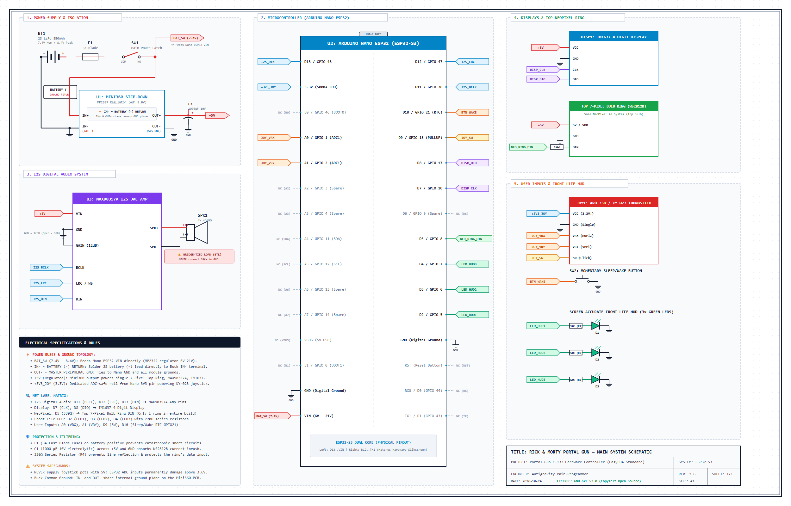
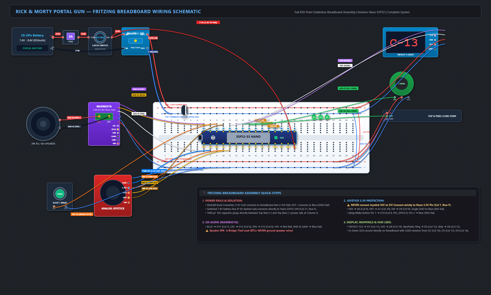

# 🌌 Rick and Morty Portal Gun (ESP32-S3 / Arduino Nano ESP32)

[](https://platformio.org/)
[-blue.svg?logo=arduino)](https://store.arduino.cc/products/nano-esp32)
[](https://wokwi.com/)
[](LICENSE)

An ultra screen-accurate, fully interactive **Rick and Morty Portal Gun** firmware and hardware build. Powered by the **ESP32-S3** (Arduino Nano ESP32), this prop features authentic sound effects, high-fidelity I2S digital audio with music soundtracks, real-time universe dialing on a 7-segment display, animated NeoPixel portal rings, phone-based Wi-Fi captive portal color tuning, and **playable 7-segment retro mini-games (Dino Runner & Snake Jazz)** right on the gun!

---

## 📑 Table of Contents
1. [✨ Feature Highlights](#-feature-highlights)
2. [🎮 Controls & Operation](#-controls--operation)
3. [🚀 Special Dimensions & Mini-Games](#-special-dimensions--mini-games)
4. [🛠️ Hardware & Components](#️-hardware--components)
5. [🔌 Wiring Diagram & Pinout](#-wiring-diagram--pinout)
6. [🖨️ 3D Printing Files](#️-3d-printing-files)
7. [💻 Firmware Installation & Build](#-firmware-installation--build)
8. [🧪 Wokwi Browser Simulation](#-wokwi-browser-simulation)

---

## ✨ Feature Highlights

* **🎛️ Physical Universe Dialing**: Dial from Universe `A-001` through `Z-999` using the analog joystick. Defaults to Rick Sanchez's home universe: **`C-137`**.
* **⚡ Firing Portal Beam**: Pressing the joystick button triggers an authentic portal blast (`snd_portal_open1`), illuminating the 7-LED top fluid bulb ring with pulsing interdimensional plasma.
* **🦖 Playable Chrome T-Rex Dino Runner**: Play the iconic offline dinosaur jumping game across the 4 digits of the TM1637 display, complete with the looping official soundtrack *"Jesus Was a Dinosaur"*!
* **🐍 Playable 7-Segment Snake Game**: Full snake game moving across 7-segment display segments with 4-way steering, food spawning, and the official looping **Snake Jazz** track.
* **🎲 Interdimensional Chamber Roulette**: A Russian Roulette gambling minigame with cylinder ratcheting sounds, tense heartbeat LEDs, and an explosive blast followed by Rick gloating: *"Riggity Riggity Wrecked Son!"*.
* **🎙️ Rick Sanchez Voice Soundboard (44 Quotes)**: Authentic voice lines from the show with live speech LED pulses and 4-letter TM1637 subtitles (`PCKL`, `WUBB`, `RIGG`, `bUtr`, etc.).
* **🎵 Evil Morty Theme & The Golden Portal**: Dedicated mode that plays the orchestral *Evil Morty Theme* (For the Damaged Coda) with atmospheric amber breathing pulses.
* **🎉 Party Mode (Get Schwifty)**: Plays *Get Schwifty* with 3-band audio reactive equalizer lighting and synchronized scrolling karaoke lyrics.
* **🌐 Phone Web App & Live Color Tuning**: Spawns an internal Wi-Fi Access Point (`Portal-Gun-C137`) with a captive portal web page. Features a live 360° rainbow hue slider to tune your portal beam color in real-time, plus one-tap character presets (Jerry Green, Morty Yellow, Unity Blue, Summer Pink, Beth Red, Rick White).
* **📡 Citadel & Federation Proximity Radar**: Sweeps the outer 6 top bulb LEDs in a rotating sonar beam and uses Bluetooth LE to scan for nearby phones, alerting you to Federation spies (`FDED`) and Rival Ricks (`R1CK`).
* **🔦 High-Power Torch**: Double-click on `'L'` to drive the top 7-pixel NeoPixel ring at 100% pure white (`255, 255, 255`) for a bright cosplay flashlight.
* **🔋 Power Management**: Push-button power switch with deep sleep (sub-milliamp battery preservation) and smooth power-down/power-up sequences.

---

## 🎮 Controls & Operation

```
               [ UP: Increase Letter / Jump ]
                              ▲
                              │
  [ LEFT: Decrement Number ] ◄─┼─► [ RIGHT: Increment Number ]
                              │
                              ▼
             [ DOWN: Decrease Letter / Duck ]

             [ CLICK: Fire Portal Beam / Select ]
```

### 1. Dimension Selection (Idle Screen)
* **UP / DOWN**: Steps through universe dimension letters (`A` through `Z`). *Preserves your dialed number.*
* **RIGHT / LEFT**: Increments or decrements the dimension number (`001` through `999`).
* **1 CLICK**: Fires the portal beam! The top fluid bulb ring ignites with pulsing green plasma while the blast sound plays.
* **2 CLICKS (Double-Click)**: Opens the **Special Dimension Mode** corresponding to the selected letter (e.g., `'D'` for Dino Runner, `'S'` for Snake Game, `'U'` for Wi-Fi tuning).
* **3 CLICKS (Triple-Click)**: **Universal Escape Hatch** — Instantly closes any active portal beam, stops any playing music or quote, and returns to Dimension Selection from anywhere!

---

## 🚀 Special Dimensions & Mini-Games

Dial the letter on the TM1637 display and **Double-Click (2 Clicks)** to enter:

| Code | Mode Name | Description | Hidden Cheat Code |
| :---: | :--- | :--- | :--- |
| **`D-003`** | **🦖 Chrome Dino Runner** | Jump over small/tall cacti and duck under low birds! Plays looping *"Jesus Was a Dinosaur"*. Push **UP** to jump, **DOWN** to duck. Displays alive score in seconds (` 38s`). | Dial `D-005`, `D-010`, or `D-099` to start with **5, 10, or 99 lives**! |
| **`S-003`** | **🐍 7-Segment Snake** | Steer the snake across digit segments with 4-way steering while listening to looping **Snake Jazz**! Eats blinking food and grows up to 28 segments. | Dial `S-005` or `S-020` to start with **5 or 20 lives**! |
| **`R-006`** | **🎲 Chamber Roulette** | 6-chamber cylinder. Click to pull the trigger: safe metallic clacks or explosive boom with Rick's *"Riggity Riggity Wrecked Son!"*. | Dial `R-002` (50/50 chance) or `R-010` (10 chambers) to customize odds! |
| **`E-001`** | **🎻 Evil Morty Theme** | Golden portal mode playing the full *For the Damaged Coda* theme with golden amber lighting and scrolling marquee (`EVIL MORTY `). | — |
| **`P-001`** | **🎉 Party Mode** | Plays *Get Schwifty* with audio-reactive EQ lighting and synchronized scrolling lyrics (`SHOW ME WHAT YOU GOT`). | — |
| **`Q-044`** | **🎙️ Rick Quotes (44 Lines)** | Speaks Rick's most iconic lines with talking LEDs. Push joystick in **any direction** (UP/DOWN/LEFT/RIGHT) to sample quotes! | Dial `Q-001` for Pickle Rick (`PCKL`), `Q-005` for Butter Robot, etc. |
| **`U-001`** | **🌐 Web App / Color Tuner** | Spawns `Portal-Gun-C137` Wi-Fi AP. Connect your phone to tune portal beam RGB color live via a 360° hue slider. | — |
| **`B-001`** | **📡 Citadel Radar** | 60-second sonar sweep (`b-60` ... `b-00`) scanning for Bluetooth LE signals with Federation & Rival Rick proximity alerts. | — |
| **`L-001`** | **🔦 High-Power Torch** | 100% brightness pure white flashlight (`LItE`). | — |

---

## 🛠️ Hardware & Components

| Component | Recommendation | Function / Notes |
| :--- | :--- | :--- |
| **Microcontroller** | **Arduino Nano ESP32** (ESP32-S3, 16MB Flash) | Full 16MB flash accommodates all high-res audio tracks, Wi-Fi, BLE, and game logic. |
| **Audio DAC & Amp** | **MAX98357A I2S DAC Amplifier** | Clear, loud 3W digital audio without PWM noise or buzzing. |
| **Speaker** | **4Ω or 8Ω 3W Mini Speaker** (28mm – 40mm) | Mounted in the gun body or handle base for rich sound. |
| **Display** | **TM1637 4-Digit 7-Segment Display** (Red, 0.36") | Displays dimension coordinates, mini-games, and HUD. |
| **Top Bulb LEDs** | **WS2812B 7-Pixel LED Ring** | Placed inside top transparent fluid bulb. (The ONLY NeoPixel ring in the gun). |
| **Front LEDs** | **3x 3mm or 5mm Green LEDs** + 220Ω Resistors | Screen-accurate front indicator LEDs and physical Life Count HUD (no NeoPixels at nozzle). |
| **Joystick** | **Analog Thumb Joystick (KY-023 / ARD-358)** | Dual-axis analog stick with center push-button switch. |
| **Power Button** | **Momentary Push Button** | Connected to `D10` (RTC GPIO) for waking and sleeping. |
| **Battery & Power** | **2S LiPo / Li-Ion (7.4V, 850mAh)** + 5V Buck Regulator (or direct VIN) | Compact 2S pack powering the 5V bus (LEDs/Amp) and Nano ESP32 VIN (6V–21V tolerant). |

> [!CAUTION]
> **Power the Analog Joystick from 3.3V, NOT 5V!**  
> The ESP32-S3 ADC inputs are strictly 3.3V-tolerant. Supplying 5V to the joystick potentiometer will permanently damage the microcontroller ADC pins.

---

## 🔌 Complete Wiring Diagrams & Assembly Schedule

### Standard Engineering Schematic (EasyEDA / KiCad Net-Standard)
Clean, professional schematic organized into modular functional blocks with zero crossing wire clutter using industry-standard net labels:

* *EasyEDA Project File*: [`portal_gun_easyeda.json`](./portal_gun_easyeda.json) (import into [EasyEDA Editor](https://easyeda.com/editor) via `File > Open > EasyEDA...`)
* *Vector SVG*: [`easyeda_schematic_diagram.svg`](./easyeda_schematic_diagram.svg)

### Physical Breadboard & Module Diagram (Fritzing)
Direct pin-to-pin physical wiring view showing actual component appearances:

* *Native Fritzing Sketch*: [`portal_gun.fzz`](./portal_gun.fzz)

> [!IMPORTANT]
> **Key Electrical & Assembly Highlights**:
> * **3A Inline Fuse**: Install a 3A mini blade or PPTC resettable fuse right next to the 2S battery positive lead to protect against accidental chassis shorts.
> * **Brownout-Proof MCU Powering**: Powering the Arduino Nano ESP32 `VIN` pin directly from the switched 2S battery (7.4V–8.4V) utilizes its onboard MP2322 switching step-down converter (rated 6V–21V). This completely isolates the MCU from 5V voltage drops when the 3.2W amplifier or NeoPixels hit peak load.
> * **Step-Down Converter Ground Architecture (`IN-` vs `OUT-`)**:
>   - **`IN-` is the BATTERY GROUND**: Solder the negative lead of the 2S battery pack directly to the buck converter's **`IN-`** pad. This completes the primary 7.4V–8.4V high-current battery circuit.
>   - **`OUT-` is the SYSTEM GROUND**: Connect your central **Master Common GND Bus** to **`OUT-`**. All downstream electronics (Nano ESP32 GND, MAX98357A GND, NeoPixel GND, TM1637 GND, Joystick GND, front LEDs cathode GND, and Sleep button GND) tie to this bus.
>   - **Shared Ground Plane**: On standard non-isolated buck converters (like Mini360 or MP1584), `IN-` and `OUT-` share the module's continuous internal copper ground plane. Soldering battery negative to `IN-` and the system ground bus to `OUT-` enforces a clean star-ground topology with zero ground loops and zero audio buzz.
> * **Power the Analog Joystick from 3.3V, NOT 5V!** The ESP32-S3 ADC inputs are strictly 3.3V-tolerant. Supplying 5V to the joystick potentiometer will permanently damage ADC pins `A0` & `A1`.
> * **Audio Grounding**: Tie all component grounds to a central star ground bus or strip to eliminate audio hum and NeoPixel noise.

---

### ⚡ 1. Battery, Fuse, Latching Power Switch & Buck Converter

| Wire # | Origin Component & Pin | Wire Spec | Destination Component & Pin | Wire Function & Assembly Notes |
| :-: | :--- | :--- | :--- | :--- |
| **P-01** | **2S Battery (+)** | 🔴 Red, 20–22 AWG | **3A Inline Fuse: In** | Raw positive battery voltage (7.4V nominal, 8.4V peak). Place fuse close to battery. |
| **P-02** | **3A Inline Fuse: Out** | 🔴 Red, 20–22 AWG | **Latching Switch: COM / Pin 1** | Fused positive supply into master latching power switch. |
| **P-03** | **Latching Switch: NO / Pin 2** | 🔴 Red, 20–22 AWG | **Switched Raw (+) Node** | Switched battery positive rail (live only when latching switch is ON). |
| **P-04** | **Switched Raw (+) Node** | 🔴 Red, 20–22 AWG | **Buck Converter: IN+** | Supplies switched 7.4V–8.4V power into the Mini360 step-down converter. |
| **P-05** | **Switched Raw (+) Node** | 🔴 Red, 22–24 AWG | **Arduino Nano ESP32: VIN** | **Powers MCU via onboard MP2322 regulator (6V–21V rated). Completely decouples MCU from 5V audio noise!** |
| **P-06** | **2S Battery (-)** | ⚫ Black, 20–22 AWG | **Buck Converter: IN- (BAT -)** | **Primary Battery Ground Return**: Solder the negative wire of the 2S battery pack directly to `IN-`. This is the battery ground. |
| **P-07** | **Buck Converter: OUT+** | 🔴 Red, 20–22 AWG | **Master +5.0V Power Bus** | Regulated +5.0V output rail (adjust trimmer to exactly 5.0V with a multimeter before connecting load). |
| **P-08** | **Buck Converter: OUT- (SYS GND)** | ⚫ Black, 20–22 AWG | **Master Common GND Bus** | **Master Peripheral Ground Star Point**: Provides the 0V reference for all internal electronics. *(IN- and OUT- share the internal GND plane).* |
| **P-09** | **Master +5.0V Bus** | 🔴 Red, 24 AWG | **Latching Switch: LED (+)** | Powers switch internal LED from regulated 5V (if using an illuminated push button). |
| **P-10** | **Master Common GND Bus** | ⚫ Black, 24 AWG | **Latching Switch: LED (-)** | Ground return for the switch's internal illuminated LED ring. |

---

### 🔋 2. Regulated Power Distribution (+5V Bus & +3.3V Dedicated Rail)

| Wire # | Origin Power Rail | Wire Spec | Destination Component & Pin | Wire Function & Assembly Notes |
| :-: | :--- | :--- | :--- | :--- |
| **PWR-01** | **Master +5.0V Bus** | 🔴 Red, 22 AWG | **MAX98357A I2S Amp: VIN** | Clean 5V supply for punchy 3.2W digital audio playback. |
| **PWR-02** | **Master +5.0V Bus** | 🔴 Red, 24 AWG | **TM1637 Display: VCC** | 5V power for 4-digit 7-segment display module. |
| **PWR-03** | **Master +5.0V Bus** | 🔴 Red, 22 AWG | **Top NeoPixel Ring: 5V / VDD** | Powers the sole 7-pixel WS2812B fluid bulb ring. |
| **PWR-04** | **Nano ESP32: 3.3V Out Pin** | 🔵 Blue, 24 AWG | **Analog Joystick: VCC** | **⚠️ MUST BE 3.3V!** Powers joystick potentiometers safely for ADC inputs (`A0` & `A1`). |
| **CAP-01** | **Master +5.0V Bus** | 🔴 Red | **470µF–1000µF 10V Cap (+)** | Across +5V and GND near LED power rail to absorb switch-on inrush current spikes. |
| **CAP-02** | **Master Common GND Bus** | ⚫ Black | **470µF–1000µF 10V Cap (-)** | Observe negative stripe polarity! |

---

### ⏚ 3. Master Common Ground Distribution (GND Star Bus)

| Wire # | Origin Component & Pin | Wire Spec | Destination Ground Point | Wire Function & Assembly Notes |
| :-: | :--- | :--- | :--- | :--- |
| **GND-01** | **Arduino Nano ESP32: GND** | ⚫ Black, 22 AWG | **Master Common GND Bus** | Microcontroller digital logic ground reference. |
| **GND-02** | **MAX98357A I2S Amp: GND** | ⚫ Black, 22 AWG | **Master Common GND Bus** | Audio amplifier power ground. |
| **GND-03** | **MAX98357A Amp: GAIN** *(Optional)* | ⚫ Black, 24 AWG | **Master Common GND Bus** (or local GND) | **Gain Boost (+12dB)**: Connect to GND for +12dB (loud convention volume). **Alternatively, leave pin UNCONNECTED (floating) for default +9dB** (cleanest audio, saves 1 wire!). |
| **GND-04** | **TM1637 Display: GND** | ⚫ Black, 24 AWG | **Master Common GND Bus** | 7-segment display logic ground. |
| **GND-05** | **Top NeoPixel Ring: GND** | ⚫ Black, 22 AWG | **Master Common GND Bus** | Top fluid chamber ring ground return. |
| **GND-06** | **3x Green LED Cathodes (-)** | ⚫ Black, 24 AWG | **Master Common GND Bus** | Common cathode ground for all 3 front green HUD LEDs. |
| **GND-07** | **Analog Joystick: GND** | ⚫ Black, 24 AWG | **Master Common GND Bus** | **Single common ground for both X/Y potentiometers and the push-button switch.** |
| **GND-08** | **Sleep/Wake Button: Pin 2** | ⚫ Black, 24 AWG | **Master Common GND Bus** | RTC wake push-button ground return line. |

---

### 🔊 4. High-Fidelity I2S Digital Audio System

| Wire # | Origin Component & Pin | Wire Color Suggestion | Destination Component & Pin | Wire Function & Assembly Notes |
| :-: | :--- | :--- | :--- | :--- |
| **AUD-01** | **Arduino Nano ESP32: D11** | 🟡 Yellow | **MAX98357A Amp: BCLK** | I2S Bit Clock line (synchronizes raw PCM sample bits). |
| **AUD-02** | **Arduino Nano ESP32: D12** | 🟣 Purple | **MAX98357A Amp: LRC** | I2S Word Select / Left-Right Clock (frame synchronization). |
| **AUD-03** | **Arduino Nano ESP32: D13** | ⚪ White | **MAX98357A Amp: DIN** | I2S Serial PCM Audio Data line. |
| **AUD-04** | **MAX98357A Amp: SPK+** | 🔴 Red (Twisted Pair) | **3W Mini Speaker: Terminal (+)** | Differential Bridge-Tied Load (BTL) speaker output. |
| **AUD-05** | **MAX98357A Amp: SPK-** | ⚫ Black (Twisted Pair) | **3W Mini Speaker: Terminal (-)** | **⚠️ NEVER connect speaker (-) to GND! It is a differential drive.** |

---

### 📟 5. TM1637 4-Digit Display & WS2812B NeoPixels

| Wire # | Origin Component & Pin | Wire Color Suggestion | Destination Component & Pin | Wire Function & Assembly Notes |
| :-: | :--- | :--- | :--- | :--- |
| **DSP-01** | **Arduino Nano ESP32: D7** | 🟣 Purple | **TM1637 Display: CLK** | Serial clock line for 4-digit dimension coordinate display. |
| **DSP-02** | **Arduino Nano ESP32: D8** | ⚪ White | **TM1637 Display: DIO** | Bi-directional serial data line for coordinate & game rendering. |
| **LED-01** | **Arduino Nano ESP32: D5** | 🟢 Green | **330Ω Resistor ➔ Top Ring: DIN** | Top 7-pixel fluid bulb ring data signal (sole NeoPixel ring; 330Ω resistor near DIN). |

---

### 💡 6. Screen-Accurate Front Indicator LEDs (PWM Life HUD)

| Wire # | Origin Component & Pin | Inline Component | Destination Component & Pin | Wire Function & Assembly Notes |
| :-: | :--- | :--- | :--- | :--- |
| **HUD-01** | **Arduino Nano ESP32: D2** | **220Ω Resistor R1** | **Green LED 1: Anode (+)** | Left front HUD LED (software PWM breathing & Life 1; ~5.5mA safe direct GPIO drive). |
| **HUD-02** | **Arduino Nano ESP32: D3** | **220Ω Resistor R2** | **Green LED 2: Anode (+)** | Center front HUD LED (software PWM breathing & Life 2; ~5.5mA safe direct GPIO drive). |
| **HUD-03** | **Arduino Nano ESP32: D4** | **220Ω Resistor R3** | **Green LED 3: Anode (+)** | Right front HUD LED (software PWM breathing & Life 3; ~5.5mA safe direct GPIO drive). |

---

### 🕹️ 7. Navigation Controls & Power Sleep/Wake Buttons

| Wire # | Origin Component & Pin | Wire Color Suggestion | Destination Component & Pin | Wire Function & Assembly Notes |
| :-: | :--- | :--- | :--- | :--- |
| **INP-01** | **Analog Joystick: VRX** | 🟠 Orange | **Arduino Nano ESP32: A0** | Horizontal axis potentiometer voltage (0V to 3.3V analog input). |
| **INP-02** | **Analog Joystick: VRY** | 🟡 Yellow | **Arduino Nano ESP32: A1** | Vertical axis potentiometer voltage (0V to 3.3V analog input). |
| **INP-03** | **Analog Joystick: SW** | 🟤 Brown | **Arduino Nano ESP32: D9** | Center click pushbutton (active LOW with ESP32 internal `INPUT_PULLUP`). |
| **INP-04** | **Sleep/Wake Button: Pin 1**| 🟠 Orange | **Arduino Nano ESP32: D10** | Momentary soft power button (mapped to ESP32-S3 `RTC_GPIO21` for `EXT0` deep-sleep wake). |

---

## 🖨️ 3D Printing Files

The 3D printable CAD models for the portal gun chassis are organized in the project folder:
* **`Chassis / Main Shell`**: Left & Right clamshell body with battery compartment and internal PCB mounts.
* **`Front Barrel Nozzle`**: Front emitter cone and acrylic diffuser lens (no internal electronics).
* **`Top Fluid Cylinder`**: Houses the single 7-LED WS2812B NeoPixel ring under a frosted green cylinder/dome.
* **`Display Bezel`**: Snug front snap-fit bezel for the 0.36" TM1637 4-digit display module.
* **`Electronics Sled`**: Slide-in mounting tray securing the Arduino Nano ESP32, MAX98357A amplifier, and 2S 850mAh battery compartment.

*(Recommended Print Settings: PLA or PETG, 0.2mm layer height, 15-20% infill, supports required on clamshell handles).*

---

## 💻 Firmware Installation & Build

### Prerequisites
1. Install [VS Code](https://code.visualstudio.com/) with the [PlatformIO IDE Extension](https://platformio.org/).
2. Install [Python 3.10+](https://www.python.org/) and ensure it is added to your system `PATH`.
3. (Optional) Install `ffmpeg` if you plan to convert custom audio tracks.

### Step 1: Clone the Repository
```bash
git clone https://github.com/your-username/portal-gun-esp32.git
cd portal-gun-esp32
```

### Step 2: Audio Conversion & Asset Generation
The project includes a Python audio pipeline that converts all audio files to raw 11,025 Hz 8-bit unsigned mono PCM arrays packed into flash memory:
```bash
python tools/generate_extra_audio.py
```
*(You will see all tracks—including Evil Morty, Snake Jazz, and Dino Song—packed into `include/extra_audio.h` and `src/modules/extra_audio.cpp`).*

### Step 3: Build & Flash
Connect your **Arduino Nano ESP32** via USB-C and run:
```bash
pio run -e arduino_nano_esp32 --target upload
```

To monitor debug serial output:
```bash
pio device monitor -b 115200
```

---

## 🧪 Wokwi Browser Simulation

Want to test the firmware before wiring the hardware? You can run the entire portal gun in the [Wokwi](https://wokwi.com/) simulator:

1. Build the simulation target:
   ```bash
   pio run -e esp32dev
   ```
   *(PlatformIO automatically merges the bootloader, partition table, and firmware into `.pio/build/esp32dev/firmware.merged.bin`)*.
2. In VS Code, install the **Wokwi for VS Code** extension.
3. Open `diagram.json` and press **F1** $\rightarrow$ `Wokwi: Start Simulator`.
4. Interact with the virtual joystick, 7-segment display, NeoPixels, and buzzer directly in your browser!

---

## 📜 License & Open Source

This project (firmware, schematics, and 3D CAD files) is released under the **[GNU General Public License v3.0 (GPL-3.0)](LICENSE)** — the exact same copyleft license used by **Blender** and **Prusa Research** because I used them:

* **Freedom to Use & Modify**: You are completely free to build, run, modify, and improve this portal gun for your own projects and cosplay.
* **Share-Alike Requirement**: If you modify, redistribute, or release your own versions (firmware, hardware mods, or remix 3D files), you **must share your modifications as open source under the same GNU GPL v3 license**.
* **Disclaimer**: Rick and Morty, character names, and audio clips are trademarks and copyright of Adult Swim / Warner Bros. Discovery. This is an open-source non-commercial fan tribute prop project.

---

> *"Wubba Lubba Dub Dub! Grab your portal gun and let's go, Morty!"* 🥒
